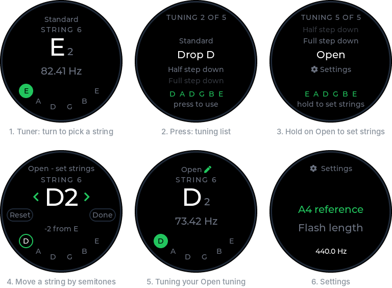
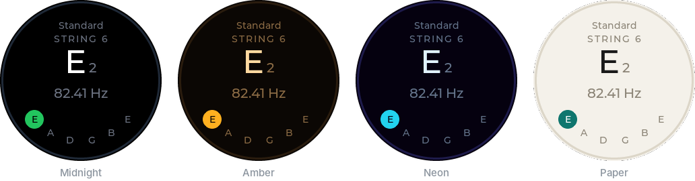
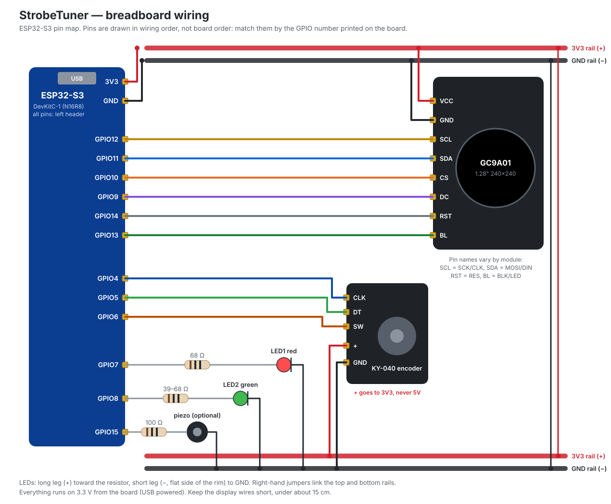

# StrobeTuner

A "strobe" guitar tuner for the ESP32-S3 (or ESP32-S2), with a 240×240 round GC9A01 display and a rotary encoder.

It started as a port of [StrobeTuner](https://github.com/chazomaticus/strobetuner), an Arduino library by Charles Lindsay (2013), and has grown into a standalone project.

Two LEDs flash alternately at the note's frequency. When you shine them on a vibrating string, the string looks frozen if it's in tune and drifts if it's sharp or flat. The display shows the note and handles all configuration.



Four colour themes, chosen in Settings:



These images come straight from the simulator (`./build/strobetuner_sim --shots shots`), so they show exactly what the GC9A01 displays.

```
.
├── lv_conf.h                    LVGL config (shared by device + simulator)
├── strobetuner_esp32s2/         Arduino sketch
│   ├── strobetuner_esp32s2.ino  hardware: strobe timer, display, encoder, storage
│   └── src/
│       ├── core/tuner.*         settings, the five tunings, note maths
│       ├── core/strobe_math.h   LED flash schedule (same code on device and in tests)
│       ├── ui/ui.*              ← all screens, themes and menus live here
│       └── hw/gc9a01.*          display driver (ESP-IDF esp_lcd, SPI + DMA)
├── docs/                        breadboard guide, wiring diagram, screenshots
└── simulator/                   runs src/ui on your Mac in a round window,
                                 plus strobe_test (timing checks)
```

`src/ui` and `src/core` are compiled unchanged for the ESP32 and the Mac. Whatever you design in the simulator is exactly what the device shows.

## Designing the UI on your Mac

One-time setup:

```
brew install cmake sdl2
cd simulator
cmake -B build
cmake --build build -j
```

The first build downloads LVGL 9.6.0 from GitHub. If you already have it from the Arduino Library Manager, you can point the build at that copy instead: `cmake -B build -DLVGL_DIR=~/Documents/Arduino/libraries/lvgl`.

Run the simulator:

```
./build/strobetuner_sim
```

A 480×480 window (2× zoom) shows the round screen. These keys stand in for the encoder:

| Encoder | Simulator |
|---|---|
| Turn clockwise / anticlockwise | Mouse wheel, or the arrow keys |
| Press | Wheel click, or Enter |
| Hold (long press) | Hold the wheel click, or Esc / Backspace |

The terminal prints what the strobe would be set to after each change.

**Edit → rebuild → look:** change `src/ui/ui.c`, run `cmake --build build`, and run the simulator again. The places you're most likely to edit:

- `THEMES[]`: colour schemes. Add an entry and it appears in Settings → Theme.
- `build_tune()`, `build_list()`, `build_open()`, `build_menu()`, `build_edit()`: layout of each screen.
- `SETTINGS[]`: what's in the settings menu, the value ranges and the step sizes.
- `NAMES[]` and `FIXED[]` in `src/core/tuner.c`: the fixed tunings.

**Screenshots without a window:** run `./build/strobetuner_sim --shots shots`. This renders every screen in every theme to `shots/*.bmp`. It's handy for comparing variations side by side, or for giving an AI assistant something to look at.

## Hardware

- ESP32-S3 board: ESP32-S3-DevKitC-1 or a clone (e.g. the N16R8 boards with two USB-C ports). ESP32-S2 boards (Saola-1, DevKitM-1, Lolin S2 Mini) also work, with their own pin map
- GC9A01 1.28″ 240×240 round display module (SPI)
- Rotary encoder with push switch (e.g. KY-040 or a bare EC11)
- Red and green LEDs (clear lens, high brightness), with 68 Ω resistor for the red and 39–68 Ω for the green
- Optional, for checking the frequency with a phone: a small **passive** piezo disc or buzzer and a 100 Ω resistor

## Wiring

**Building it for the first time?** Follow the step-by-step [breadboard guide](docs/breadboard.md). It builds and tests one part at a time and has a troubleshooting table.



| Part | Pin | ESP32-S3 | ESP32-S2 |
|---|---|---|---|
| LED1 (red) | via 68 Ω to GND | GPIO7 | GPIO7 |
| LED2 (green) | via 39–68 Ω to GND | GPIO8 | GPIO8 |
| GC9A01 | SCL / SCK | GPIO12 | GPIO36 |
| | SDA / MOSI | GPIO11 | GPIO35 |
| | CS | GPIO10 | GPIO34 |
| | DC | GPIO9 | GPIO38 |
| | RST | GPIO14 | GPIO33 |
| | BL (backlight) | GPIO13 | GPIO21 |
| | VCC / GND | 3V3 / GND | 3V3 / GND |
| Encoder | A (CLK) | GPIO4 | GPIO9 |
| | B (DT) | GPIO5 | GPIO10 |
| | SW | GPIO6 | GPIO11 |
| | + / GND | 3V3 / GND | 3V3 / GND |
| Piezo (optional) | via 100 Ω, other leg to GND | GPIO15 | GPIO12 |

The sketch picks the pin map for the chip you compile for. On the S3 every signal is on the left header (GPIO 4–15) and stays clear of GPIO 35–37, which N16R8 modules use for their PSRAM.

All pins are set at the top of the sketch. Don't move anything onto the boot/strapping pins (GPIO0, 3, 45, 46), or onto GPIO19/20 (USB). The board's BOOT button also works as "press".

If turning the encoder clockwise moves backwards, set `ENC_REVERSE = true`. If one detent moves two steps, or it takes two detents to move one step, change `ENC_COUNTS_PER_DETENT` (4 or 2).

## Controls

| Screen | Turn | Press | Hold |
|---|---|---|---|
| Tuner | next/previous string | open the tuning list | strobe on/off |
| Tuning list | scroll | use that tuning (or open Settings) | on **Open**: set its strings; elsewhere: back |
| Open string editor | pick string 6…1, Reset or Done | edit that string, then turn to move it a semitone at a time; press again when done | back to the tuner |
| Settings | choose item | edit item | back to the tuner |
| Editing a setting | change it (applies live; spin fast for big steps) | back | back |

**Tunings:** Standard, Drop D, Half step down, Full step down and **Open**. Open is your own tuning: it starts as Standard, and you set each string up to 7 semitones either way. Reset puts it back to Standard.

**Settings:** A4 reference, flash length, clock trim, brightness, theme and reference tone.

Everything, including the tuning and string you were on and your Open strings, is saved to flash two seconds after the last change. The tuner comes back exactly where you left it after power-up.

## Build and flash (Arduino IDE)

1. In **Preferences → Additional boards manager URLs**, add `https://espressif.github.io/arduino-esp32/package_esp32_index.json`.
2. In **Boards Manager**, install **esp32 by Espressif** (tested with 4.0.0).
3. In **Library Manager**, install **lvgl** version 9.6.x.
4. Copy `lv_conf.h` to your sketchbook's `libraries` folder, so it sits *next to* the `lvgl` folder (usually `~/Documents/Arduino/libraries/lv_conf.h`).
5. Open `strobetuner_esp32s2/strobetuner_esp32s2.ino`.
6. Select your board:
   - **ESP32-S3 (N16R8 DevKitC-1 style):** **ESP32S3 Dev Module**, Flash Size **16MB**, PSRAM **OPI PSRAM** or Disabled.
   - **ESP32-S2:** **ESP32S2 Dev Module** or **LOLIN S2 Mini**.

   Set **USB CDC On Boot** to **Enabled** if you're plugged into the board's native **USB** port, or **Disabled** if you're using its **COM/UART** port.
7. Upload. If it won't connect, hold **BOOT**, tap **RESET**, release **BOOT**, then upload again.

With arduino-cli:

```
arduino-cli compile --fqbn esp32:esp32:esp32s3:FlashSize=16M,PSRAM=opi,CDCOnBoot=cdc strobetuner_esp32s2
arduino-cli upload  --fqbn esp32:esp32:esp32s3:FlashSize=16M,PSRAM=opi,CDCOnBoot=cdc -p /dev/cu.usbmodem* strobetuner_esp32s2
```

### Serial commands (optional, 115200 baud)

`tuning 1`…`tuning 5` (Standard, Drop D, Half step down, Full step down, Open), `next`, `prev`, `on`, `off`, `a4=442`, `trim=-12.5`, `tone on`, `tone off`, `test` (see below).

## Checking that the LEDs flash at the right frequency

There are three levels of checking, from cheapest to most thorough.

**1. On your Mac, with no hardware.** `src/core/strobe_math.h` is the exact schedule the timer interrupt runs. `strobe_test` runs it for every note from A0 to C7 and for every string of every tuning, including Open at its ±7 semitone limits:

```
cd simulator && cmake --build build && ./build/strobe_test
```

It checks that the long-run flash rate equals the note (< 0.001 cent) and that every single flash is within 1 µs of ideal. It also checks that green comes half a period after red, that each flash lasts the set length, and that clock trim shifts the period by the requested ppm. It prints `ALL PASSED` or names the failure.

**2. On the device.** Open the serial monitor (115200) and type `test` (or `test 30` for 30 s). While the strobe runs, the firmware timestamps every rising and falling edge on both LED pins. It then reports:

```
LED1 red    825 flashes  period 12134.9090 us (want 12134.9078)  error -0.0002 cents  jitter 12134..12136 us  flash 250.4 us (want 250)
LED2 green  825 flashes  ...
Green after red: 6067.5 us (want 6067.5 = half a period)
PASS: LEDs flash at the requested frequency.
```

This catches missed or late flashes, wrong maths and wiring mix-ups. It measures with the board's own crystal, though, so it can't see crystal error.

**3. Against an outside reference.** The 40 MHz crystal is typically within ±10–20 ppm, which is 0.02–0.03 cent and far below what you can hear. Two ways to confirm it:

- **Phone tuner app (free).** Wire the optional piezo to GPIO12 and turn on **Settings → Ref. tone** (or type `tone on`). Pin 12 then outputs a square wave at exactly the strobe frequency, generated by the same timer interrupt as the LED flashes. Hold the phone's microphone near the piezo and open any tuner app that shows cents. It should show the selected note at 0 cents, give or take the app's own accuracy (usually ±1 cent). Your phone keeps its own time, so this is an independent check. Low strings are quiet on a small piezo, so if the app struggles, try string 1 or 2.
- **Instruments.** Clip a frequency counter, an oscilloscope or a cheap USB logic analyser (PulseView/sigrok) to GPIO7 or GPIO12. The analyser has its own crystal error of the same size.

If either method shows a consistent offset, enter it in **Settings → Clock trim**.

## How the strobe timing works

A hardware timer interrupt (ESP-IDF GPTimer) flashes the LEDs, so drawing the display never disturbs the timing. Edge times are kept in 1/65536 µs fixed point, so the average period is exact. Accuracy is then limited only by the board's 40 MHz crystal (~±20 ppm ≈ 0.03 cent). The original Arduino version rounded periods to whole microseconds, which put it up to ~0.15 cent off, and it needed a 0.999 clock fudge. If you ever calibrate against a reference tuner, set **Clock trim**.

## License

LGPL-3.0-or-later, the same licence as the original StrobeTuner library by Charles Lindsay (see `COPYING` and `COPYING.LESSER`). The GC9A01 init sequence in `src/hw/gc9a01.cpp` comes from Arduino_GFX (BSD licence, notice kept in that file).
