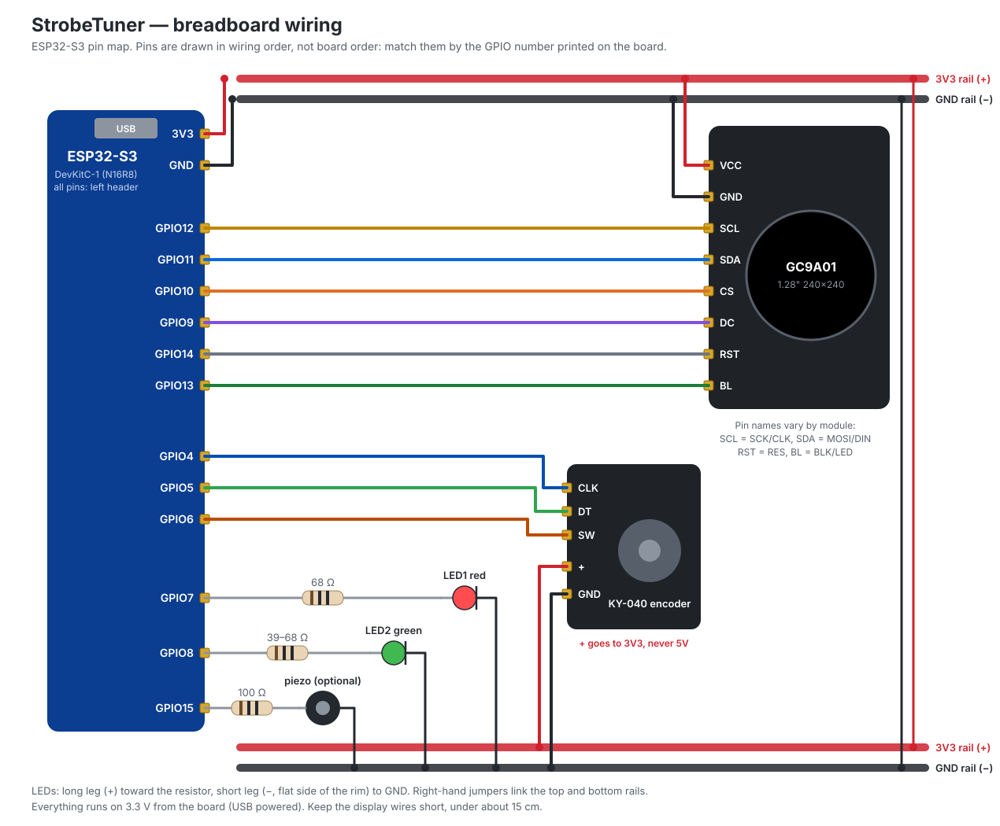

# Building StrobeTuner on a breadboard

The diagram shows **what connects to what** for an **ESP32-S3** board (ESP32-S3-DevKitC-1 or a clone, such as the N16R8 boards with two USB-C ports). Pins are drawn in wiring order, not in the order they sit on your board, so match them by the GPIO number printed next to each pin. On these boards every signal pin used here is on the **left header** (GPIO 4–15).

ESP32-S2 boards are supported too, with different pins: they're given in brackets in the tables below. The firmware picks the right set automatically when you choose the board in the Arduino IDE.

## Parts

| Qty | Part | Notes |
|---|---|---|
| 1 | ESP32-S3 board | ESP32-S3-DevKitC-1 or clone (e.g. N16R8). ESP32-S2 boards also work |
| 1 | GC9A01 1.28″ round display module (SPI, 240×240) | the 7- or 8-pin kind, labelled VCC GND SCL SDA DC CS RST (BL) |
| 1 | Rotary encoder module with push switch | KY-040 or similar (5 pins: CLK DT SW + GND) |
| 1 | Red LED, 5 mm, clear lens, high brightness | |
| 1 | Green LED, 5 mm, clear lens, high brightness | a yellow-green (≈2.1 V) LED is brighter at 3.3 V than a pure/emerald green (≈3 V) |
| 1 | 68 Ω resistor | for the red LED |
| 1 | 39–68 Ω resistor | for the green LED (68 Ω for a ≈2 V green, 39 Ω for a ≈3 V green) |
| 1 | Passive piezo disc/buzzer + 100 Ω resistor | optional, for the phone-tuner check |
| 1 | Breadboard | a full-size (830-hole) one is easiest |
| ~25 | Jumper wires | male-to-male; male-to-female for the display and encoder modules |
| 1 | USB cable | for power, flashing and the serial monitor |

## Before you start

**Breadboard basics.** The long red (+) and blue (−) strips along the top and bottom edges are the **rails**: each one is connected along its whole length. In the middle, each short column of 5 holes is connected, and the centre gap separates the two halves. On many full-size boards the rails are split in the middle (look for a gap in the red/blue line); if so, bridge each one with a short jumper.

**Placing the board.** DevKitC-style boards are wide: straddling the centre gap of one breadboard leaves at most one free hole per pin. The easy fix is two breadboards side by side with the board bridging them, so each header has free holes next to it. Or keep the board off the breadboard and use male-to-female jumpers straight onto its pins. Since all the signals are on the left header, only that side really needs free holes, plus one GND pin.

(Lolin S2 Mini: two rows of pins per side, so use male-to-female jumpers from its pins.)

**Which USB-C port.** Boards with two ports have one marked **USB** (the chip's own USB) and one marked **COM** or **UART** (a USB-serial chip). Either can flash the board. For the Serial Monitor:
- on the **USB** port, set **Tools → USB CDC On Boot → Enabled**;
- on the **COM/UART** port, leave it **Disabled**.

**Arduino IDE settings for an N16R8 ESP32-S3:** Board **ESP32S3 Dev Module**, Flash Size **16MB**, PSRAM **OPI PSRAM** (or Disabled: the tuner doesn't need it). If your board is a different variant, the defaults are fine.

**Flash the firmware first** (see the main [README](../README.md)). It runs without the display or encoder attached, which lets you build and test one part at a time. Open the Serial Monitor at 115200 baud: the board prints a line every time something changes.

**Always unplug USB while you change wiring.**

## Step 1: power rails

1. Board **3V3** → top **red (+)** rail.
2. Board **GND** → top **blue (−)** rail.
3. Link the top and bottom rails: one jumper red-to-red, one blue-to-blue.

Use the **3V3** pin, not **5V/VBUS**. Everything in this build is 3.3 V.

## Step 2: LEDs, then check the strobe

1. **GPIO7** (S2: GPIO7) → 68 Ω resistor → **long leg** of the red LED. Short leg (the flat side of the rim) → **GND** rail.
2. **GPIO8** (S2: GPIO8) → 39–68 Ω resistor → **long leg** of the green LED. Short leg → **GND** rail.

**Check:** power up. Both LEDs should glow dimly and steadily: each one flashes briefly 80–330 times a second, too fast to see as flashing. In the Serial Monitor type `test`. After 10 seconds it should print `PASS`. If one LED shows "no flashes seen", check that it isn't in backwards.

## Step 3: display

| Display pin | ESP32-S3 | (ESP32-S2) |
|---|---|---|
| VCC | 3V3 rail | 3V3 rail |
| GND | GND rail | GND rail |
| SCL (SCK, CLK) | GPIO12 | GPIO36 |
| SDA (MOSI, DIN) | GPIO11 | GPIO35 |
| CS | GPIO10 | GPIO34 |
| DC | GPIO9 | GPIO38 |
| RST (RES) | GPIO14 | GPIO33 |
| BL (BLK, LED) | GPIO13 | GPIO21 |

If your module has no BL pin, skip it: the backlight is then always on. Some modules have a MISO/SDO pin; leave it unconnected.

Keep these wires short, ideally under 15 cm. The display runs at 40 MHz and long breadboard jumpers can garble it.

**Check:** power up. The round screen should show **Standard / STRING 6 / E2 / 82.41 Hz**.

## Step 4: rotary encoder

| Encoder pin | ESP32-S3 | (ESP32-S2) |
|---|---|---|
| CLK | GPIO4 | GPIO9 |
| DT | GPIO5 | GPIO10 |
| SW | GPIO6 | GPIO11 |
| + | 3V3 rail (never 5V) | 3V3 rail |
| GND | GND rail | GND rail |

**Check:** turning the knob moves the highlight between strings, and pressing it opens the tuning list. The board's **BOOT** button also works as "press", which is handy if the encoder isn't wired yet.

## Step 5 (optional): reference tone

**GPIO15** (S2: GPIO12) → 100 Ω resistor → piezo → **GND** rail. A passive piezo has no polarity.

**Check:** in Settings, turn **Ref. tone** on (or type `tone on`). Hold your phone near the piezo with a tuner app open: it should show the selected note at about 0 cents. Higher strings (1 and 2) are easiest for the app to hear.

## Using it

Tune in a dim room. Pluck the string and look at it, or at its shadow, in the LEDs' light. When the string looks still, it's in tune; if the pattern drifts, it's sharp or flat. Mount the LEDs close to the strings and pointing at them; a short pair of wires from the breadboard lets you hold them there.

## If something doesn't work

| Problem | Try |
|---|---|
| Nothing at all, no serial output | Check the USB cable carries data; enable **USB CDC On Boot**; hold BOOT, tap RESET, release BOOT and re-upload |
| An LED never lights | It's probably backwards: swap its legs. Check the resistor is in the same row as the LED leg |
| Green LED very dim | Use 39 Ω, or a yellow-green LED (lower forward voltage) |
| Screen stays black | Check VCC/GND; BL must go to GPIO21 (or to 3V3 if your module needs it always on) |
| Screen shows noise, shifted or mirrored image | Shorten the SCL/SDA/CS/DC wires; or lower `SPI_HZ` to `20000000` in the sketch |
| Serial Monitor is empty | Match **USB CDC On Boot** to the port you're using (Enabled for USB, Disabled for COM/UART) |
| Board resets or won't boot with things attached | Make sure nothing is wired to GPIO0, 3, 45 or 46 (boot pins); the tuner doesn't use them |
| Encoder turns the wrong way | Swap the CLK and DT wires, or set `ENC_REVERSE = true` |
| One click moves two steps, or two clicks move one | Set `ENC_COUNTS_PER_DETENT` to 2 (or 4) in the sketch |
| Phone app can't hear the tone | Make sure it's a *passive* piezo, turn Ref. tone on, try string 1 |
